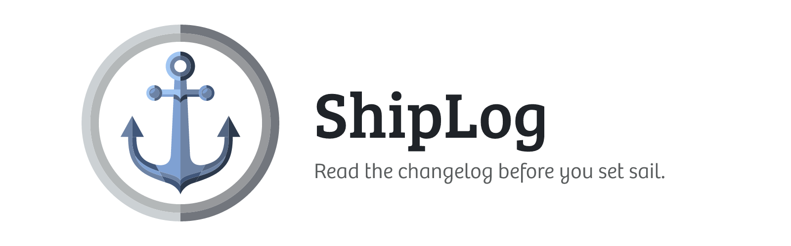
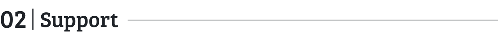
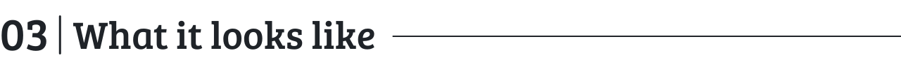
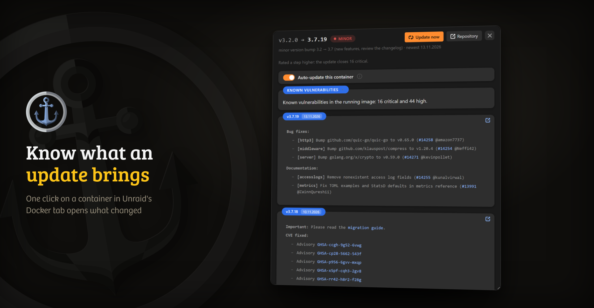
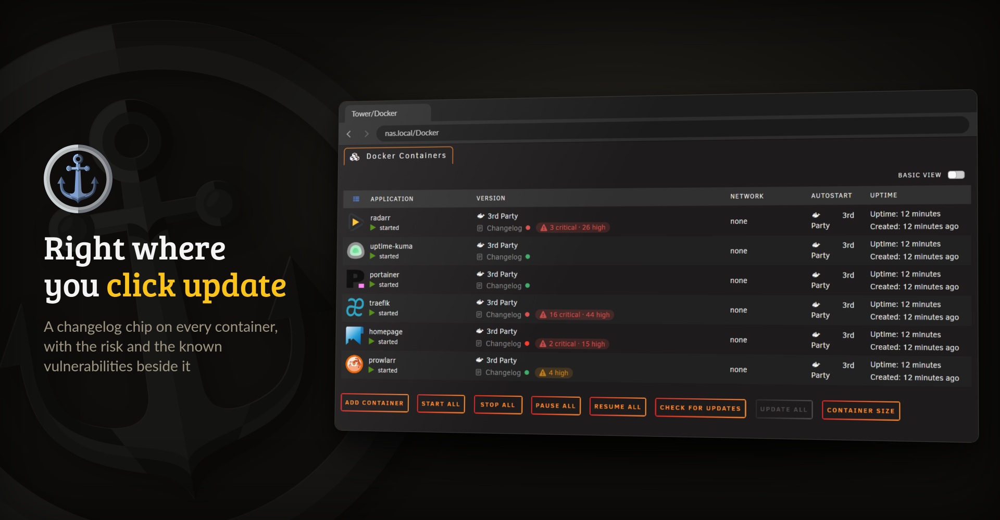
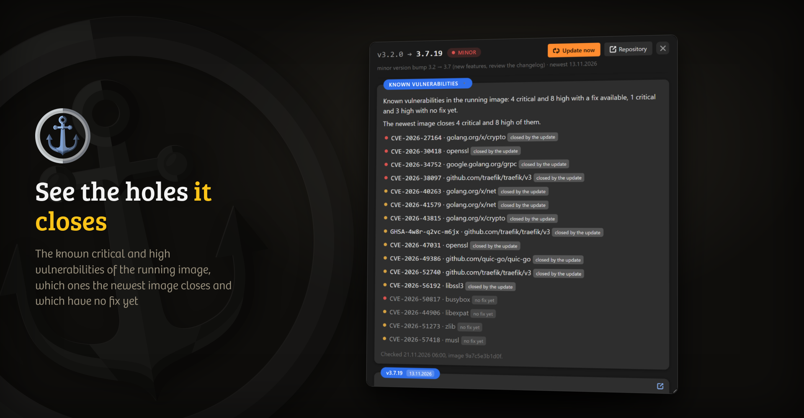
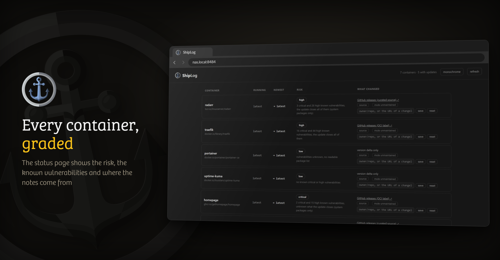
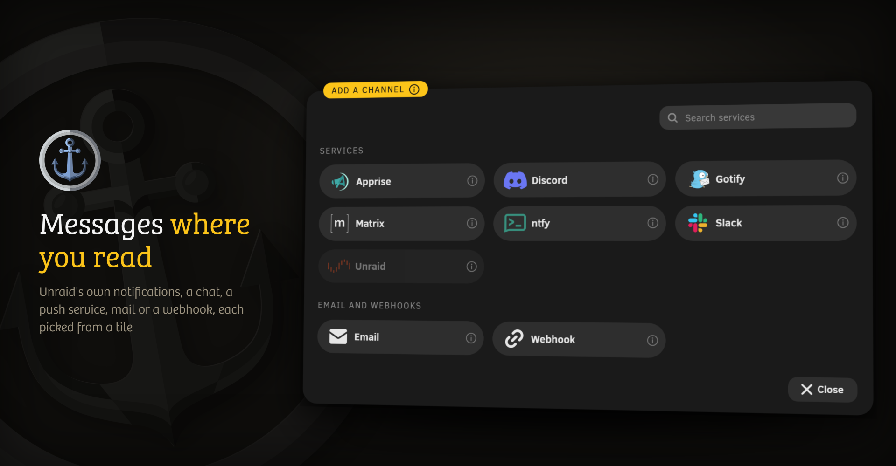
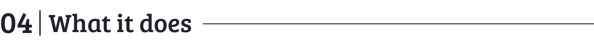

<p align="center">
  <picture>
    <source media="(prefers-color-scheme: dark)" srcset="https://raw.githubusercontent.com/junkerderprovinz/shiplog/main/.github/assets/shiplog-banner-dark.png">
    
  </picture>
</p>

<p align="center">
  <a href="https://github.com/junkerderprovinz/shiplog/actions/workflows/build.yml"></a>&nbsp;
  <a href="https://github.com/junkerderprovinz/shiplog/actions/workflows/lint.yml"></a>&nbsp;
  <a href="https://hub.docker.com/r/junkerderprovinz/shiplog"></a>&nbsp;
  <a href="https://hub.docker.com/r/junkerderprovinz/shiplog"></a>&nbsp;
  <a href="https://github.com/junkerderprovinz/shiplog/pkgs/container/shiplog"></a>&nbsp;
  <a href="https://ca.unraid.net/apps/shiplog-1lpuit5150ztw5"></a>&nbsp;
  <a href="LICENSE"></a>
</p>

<br>

<p align="center">
⚓ <b>ShipLog</b> reads the changelog before you update, right inside Unraid's native <b>Docker tab</b>. Next to each container it shows <b>what actually changes</b> between your running image and the newest: the release notes, a deterministic <b>risk badge</b> (patch / minor / major), the real <b>version jump</b> (e.g. 1.7 → 1.8) and the <b>known vulnerabilities</b> of the running image, with the ones the update closes.<br>
<br>
<b>Read-only</b> until you switch on its auto-update, which hands the work to Unraid's own update and backs up first when your fortress has a backup app. Optional: AI changelog summaries from a model server on your own network or through OpenRouter, and messages through Unraid's notifications, a chat or push service, mail or a webhook.
</p>

<br>

<p><a id="table-of-contents" href="#table-of-contents"><picture><source media="(prefers-color-scheme: dark)" srcset=".github/assets/sections/table-of-contents-dark.svg"></picture></a></p>

1. [Download](#1-download)
2. [Support](#2-support)
3. [What it looks like](#3-what-it-looks-like)
4. [What it does](#4-what-it-does)
5. [Getting started](#5-getting-started)
6. [How AI is used here](#6-how-ai-is-used-here)

<br>

<p><a id="1-download" href="#1-download"><picture><source media="(prefers-color-scheme: dark)" srcset=".github/assets/sections/1-download-dark.svg"></picture></a></p>

<!-- download-buttons: written by scripts/gen_download_buttons.py -->
<p align="center">
  <picture><source media="(prefers-color-scheme: dark)" srcset=".github/assets/sections/group-server-dark.svg"></picture>
</p>
<p align="center">
  <a href="https://ca.unraid.net/apps/shiplog-1lpuit5150ztw5"></a>
  &nbsp;
  <a href="https://github.com/junkerderprovinz/shiplog/releases/latest"></a>
</p>
<!-- /download-buttons -->

<br>

<p><a id="2-support" href="#2-support"><picture><source media="(prefers-color-scheme: dark)" srcset=".github/assets/sections/2-support-dark.svg"></picture></a></p>

<p align="center">
A one-knight job: I build it, keep it running, work through the issues and add what people ask for, until nothing is missing. It is free, with no accounts, no telemetry, no ads and no paid tier. No asterisk anywhere. Nothing readable ever leaves your own walls. Forged on evenings and weekends, with heart and stubbornness.
</p>

<p align="center">
If it has earned a place on your server or computer, toss a coin to your knight: it helps cover the costs and keeps the project alive. It also makes this knight's heart beat a little faster. Three ways below, whichever suits you.
</p>

<!-- give-buttons: written by scripts/gen_download_buttons.py -->
<p align="center">
  <a href="https://buymeacoffee.com/junkerderprovinz"></a>
  &nbsp;
  <a href="https://www.paypal.com/donate/?hosted_button_id=76FVV52TKXTUS"></a>
  &nbsp;
  <a href="https://junkerderprovinz.github.io/junkerderprovinz/"></a>
</p>
<!-- /give-buttons -->

<br>

<p><a id="3-what-it-looks-like" href="#3-what-it-looks-like"><picture><source media="(prefers-color-scheme: dark)" srcset=".github/assets/sections/3-what-it-looks-like-dark.svg"></picture></a></p>

The containers in these pictures run public images at older versions in a test sandbox. The release notes and the vulnerabilities are the real ones.

<p align="center">
  
  <br><em>The changelog window opens from the chip ShipLog adds to every container in the Docker tab</em>
</p>

<p align="center">
  
  <br><em>Every container gets a chip, with the risk as a coloured dot and the known vulnerabilities beside it</em>
</p>

<p align="center">
  
  <br><em>The window lists the known vulnerabilities and marks the ones the update closes</em>
</p>

<p align="center">
  
  <br><em>The engine's status page, the same data outside the Docker tab</em>
</p>

<p align="center">
  
  <br><em>A new channel is picked from a tile and can send everything or only what went wrong</em>
</p>

<br>

<p><a id="4-what-it-does" href="#4-what-it-does"><picture><source media="(prefers-color-scheme: dark)" srcset=".github/assets/sections/4-what-it-does-dark.svg"></picture></a></p>

- **What changed since your version.** A Changelog chip sits on every container in the Docker tab, inside folders too. Its window shows the release notes between your running tag and the newest, with the real version jump.
- **A risk badge you can trust.** Patch is low, minor medium, major high. A release note in the span that flags a breaking change, such as a required migration, raises it to critical and sends an alert. An update that closes a critical vulnerability moves up a step.
- **Known vulnerabilities.** A second chip counts the known critical and high vulnerabilities of the running image. It leads with the ones a fix is available for and shows the ones with no fix yet dimmed beside them, and only the first kind colours the chip. The window lists them, those with a fix first, and marks the ones the newest image closes. When no update closes them, it suggests asking the project for a fixed image or switching to another tag or image. The status page and the notifications name them too. The package list comes from the image's registry or from inside the container, and only package names and versions go to an open vulnerability database at api.osv.dev. Your distribution's own rating of a flaw counts before the raw score, and kernel packages are left out, since a container runs on the host's kernel. The check is on by default and can be switched off under **Settings → ShipLog → Updates**.
- **Only real updates.** The image behind the container's own tag decides whether there is an update, not the highest version tag in the registry, which is often an old date tag or another channel. A container pinned to a version gets a hint when a newer one exists, never an update it cannot pull.
- **New containers within a minute.** A container you install from a template, or one Unraid recreates after an update, gets its chip within a minute and does not wait for the next scheduled check.
- **Honest when it does not know.** If no changelog can be found, it says so and shows what it does know. Digest-pinned and locally built images are labelled as such instead of showing a bogus update.
- **Fix a wrong changelog source.** Point any image at the right GitHub repository or at a changelog file such as `CHANGELOG.md`. The choice survives container recreation.
- **Warns about dead ends.** An app pulled from Community Applications, an image gone from its registry or an archived source repository replaces the chip with a red badge. An app Community Applications only hides from its default search gets an amber one. Both Community Applications verdicts go only to apps that came from there, never to your own images and templates.
- **Updates through Unraid.** An Update all button and an optional scheduled auto-update, limited to the level you choose, hand the work to Unraid's own update. ShipLog skips a container that already runs the newest image and checks afterwards that the new image really runs. Containers you update by hand can be left out of the auto-update one by one, in the settings or from the switch in their changelog window. The engine itself touches Docker only to start a container an update lost and to hold the old image while an update runs.
- **A backup first, and a way back.** In a fortress with a backup app on the same server, every auto-update waits for a backup of its container. If the new image fails its check or turns unhealthy, ShipLog puts the container back on the old image. Your appdata stays as it is, and the backup from before the update waits in BombVault.
- **Optional extras, off by default.** Changelog summaries from a model server on your own network or through OpenRouter, and messages on the channels you pick: Unraid's own notifications, a chat or push service, mail or a webhook.
- **26 languages**, following Unraid's own setting.

<br>

<p><a id="5-getting-started" href="#5-getting-started"><picture><source media="(prefers-color-scheme: dark)" srcset=".github/assets/sections/5-getting-started-dark.svg"></picture></a></p>

On Unraid, install ShipLog from [Community Applications](https://ca.unraid.net/apps/shiplog-1lpuit5150ztw5). It is a plugin, not a container. You can also paste this address under **Plugins → Install Plugin**:

```
https://raw.githubusercontent.com/junkerderprovinz/shiplog/main/plugin/shiplog.plg
```

The chips appear in the Docker tab after the first check. The settings are under **Settings → ShipLog**, where a GitHub token raises the rate limit for release notes, the auto-update is switched on and the status page opens.

Running your own images or templates? [docs/own-apps-checklist.md](docs/own-apps-checklist.md) lists what to set so that both Unraid's update column and ShipLog stay right.

On any other Docker host the engine runs on its own and serves the status page, without the Docker tab and without updates:

```sh
docker run -d --name shiplog -p 8484:8484 \
  -v /var/run/docker.sock:/var/run/docker.sock:ro \
  -v /path/to/config:/config \
  junkerderprovinz/shiplog:latest
```

The status page has no login, so keep port 8484 inside your network.

### Notifications

ShipLog can tell you when it first sees an update. An update that auto-update will apply shows up in the run's summary instead, unless it is critical, because breaking notes may ask you to do something before the pull. Under **Settings → ShipLog → Notifications**, **Add a channel** opens a window with a tile for each service: Unraid's own notifications, which reach every agent you set up there, the common chat and push services, a notification gateway, mail and webhooks. A service can be added more than once. Each channel has its own switch, sends everything or only what went wrong, and has a test that works before you save. Every change is saved as you make it and takes effect without a restart, and a token or password you saved is never shown again.

Without Unraid, the container takes `APPRISE_URL`, or `MATRIX_HOMESERVER`, `MATRIX_TOKEN` and `MATRIX_ROOM`.

### Fortress

ShipLog can join the fortress your other apps share. Under **Settings → ShipLog → Fortress**, the card takes your phrase, the twelve words. ShipLog keeps its own keys only, never the phrase.

Once it is in, the other apps of the fortress can see how ShipLog is doing: how many containers have an update, which ones look risky, and the auto-update log. A backup app on the same server backs up each container before ShipLog's auto-update touches it. If the backup fails, the update waits and ShipLog tells you why. A container that needs no backup gets **Update without a backup** in its changelog window. ShipLog waits 30 minutes at most for a backup. To change that, set `AUTOUPDATE_BACKUP_MINUTES` in `/boot/config/plugins/shiplog/shiplog.cfg`.

A maintenance plan in another app can also ask ShipLog to update chosen containers, with the same backup and the same way back.

With TollRoll in the fortress and its notification hub switched on, ShipLog hands its messages to TollRoll, which sends them through its own channels and keeps quiet hours. The Notifications tab says so while it does, and once an update is applied, ShipLog tells TollRoll that its message is over. While no TollRoll takes them, ShipLog sends them through its own channels as before.

<br>

<p><a id="6-how-ai-is-used-here" href="#6-how-ai-is-used-here"><picture><source media="(prefers-color-scheme: dark)" srcset=".github/assets/sections/6-how-ai-is-used-here-dark.svg"></picture></a></p>

One knight builds this, and AI is one of the tools I work with, the same way I work with an editor or a compiler. It helps me write code and documentation and it checks my work, and that saves me a good many evenings. It does not make the decisions, though. I read and understand everything before it ships, and if something here breaks, that is on me and not on the tool.

You do not have to take my word for it. The code is open and every release note is written by hand. The issue tracker shows how problems actually get handled, including the ones I got wrong the first time. If you find something that is not right, open an issue and I will look at it.

<br>

Questions? Check the [support thread](https://forums.unraid.net/topic/199510-support-junkerderprovinz-shiplog/). Bugs, ideas or feature requests? Please [open a GitHub issue](https://github.com/junkerderprovinz/shiplog/issues).

<sub>ShipLog is licensed under the AGPL-3.0, which covers the code only: the name "ShipLog" and its logo are reserved, so a fork needs its own name and branding.</sub>
